# Census of elliptic and quasi-elliptic K3 surfaces over F2

This Magma code computes the 1,397,598 isomorphism classes of elliptic K3 surfaces with a section over $`\mathbf{F}_2`$ (zero section fixed, automorphisms of the base allowed) in under two minutes. It also lists the 720 Weierstrass models with $`a_1 = a_3 = 0`$, which give the quasi-elliptic fibrations, a phenomenon of characteristic 2 and 3.

## What is counted

Each surface has a Weierstrass model $`y^2 + a_1xy + a_3y = x^3 + a_2x^2 + a_4x + a_6`$ in $`\mathbf{P}(1,1,4,6)`$. Here $`a_i`$ is a binary form of degree $`2i`$ in $`s,t`$ over $`\mathbf{F}_2`$. Models are identified under $`\mathrm{GL}(2,\mathbf{F}_2)`$ acting on $`(s,t)`$ and the changes $`x \mapsto x+q`$, $`y \mapsto y+px+r`$, with $`p,q,r`$ forms of degree 2, 4, 6. A model with $`\Delta \ne 0`$ that is minimal at every place is an elliptic K3 surface.

When $`a_1 = a_3 = 0`$, the substitution $`x \mapsto x + a_2`$ removes $`a_2`$ and leaves $`y^2 = x^3 + a_4x + a_6`$. In characteristic 2 this has $`\Delta = 0`$ identically: the generic fibre over $`\mathbf{F}_2(T)`$ is regular but geometrically a cuspidal cubic, and every fibre is singular. Such a model is not counted among the elliptic surfaces above. When it is a K3 surface, its fibration is quasi-elliptic. The remaining changes of coordinates reduce $`a_4`$ and $`a_6`$ to a normal form without the monomials $`s^8, s^4t^4, t^8`$ in $`a_4`$ and the even monomials $`s^{12-2k}t^{2k}`$ in $`a_6`$, since these can be absorbed by $`x \mapsto x + p^2`$, $`y \mapsto y + px + r`$ (the changes that keep $`a_2 = 0`$).

## Files

Code:

- `elliptic_fibration_orbits_f2.m`: the orbit enumeration. `FibrationOrbitPrefixesF2` lists the 88 pairs $`(a_1,a_3)`$, `FibrationFiberOrbitKeysF2` returns one key per orbit over a pair (dropping $`\Delta = 0`$ by default), and `FibrationFromKeyF2` turns a key back into a model.
- `k3_minimality_f2.m`: `IsEverywhereMinimalF2`, which returns whether a model has $`\Delta \ne 0`$ and is minimal at the four candidate places, and the places where it is not minimal.
- `orbit-fib.m`: runs both over all 88 pairs and writes the everywhere minimal models to `census.txt`, then compresses it with `gzip` to `census.txt.gz`.
- `functions_census.m`: the functions computing the data collected for each surface, with notes on useful built-in Magma functions. `ZetaFunction(E)` returns $`P_2(u)`$ and $`Z(X,u) = 1/((1-u)P_2(u)(1-q^2u))`$ for the elliptic surface with generic fibre $`E`$, from `LFunction(E)` and the Frobenius action on the components of the reducible fibres. `PicardNumber(E)` returns $`\rho(X_{\bar{\mathbf{F}}_2})`$ and $`\rho(X_{\mathbf{F}_2})`$ from $`P_2`$, via the Tate conjecture (proved for elliptic K3 surfaces by Artin and Swinnerton-Dyer).
- `test_zeta_picard.m`: checks `ZetaFunction` and `PicardNumber` on the first 100 curves of `mini_census.m` (degree, functional equation, parity of $`\rho`$) and prints the distribution of Picard numbers.
- `timing_tests.m`: times built-in Magma functions (`LocalInformation`, `Conductor`, `TorsionSubgroup`, `LFunction`, ...) on the generic fibres of the models in `mini_census.txt`, and estimates the time for the full census. The results go to `timing_report.txt`.

Data:

- `census.txt.gz`: the 1,397,598 elliptic K3 surfaces, one model per line as the list $`[a_1,a_2,a_3,a_4,a_6]`$ with $`a_2 = 0`$, e.g. `[0, 0, t^6, s^6*t^2, s^11*t]` (4.3 MB compressed).
- `mini_census.txt`: a random sample of 1000 lines of the census (seed 2026), in the same format, for quick tests.
- `mini_census.m`: the same sample as Magma objects. After `load "mini_census.m";`, `models[i]` is the $`i`$-th model in `P<s,t>` and `curves[i]` its generic fibre over `K<T>` $`= \mathbf{F}_2(T)`$, $`T = t/s`$.
- `mini_census_stats.csv`: statistics of the 1000 models of `mini_census.txt`, one row per model: the torsion of $`E(\mathbf{F}_2(T))`$, the number of bad places and of singular fibres, the Kodaira types of the singular fibres, the degree of `LFunction(E)` and the sign of its functional equation, the analytic rank, and the Picard numbers over $`\mathbf{F}_2`$ and $`\bar{\mathbf{F}}_2`$.
- `quasi-elliptic.txt`: the 720 models with $`a_1 = a_3 = 0`$, one per line in the same format, e.g. `[0, 0, 0, 0, s*t^11]`. Which of them are K3 surfaces is not yet checked: the first line, $`[0,0,0,0,0]`$, is $`y^2 = x^3`$ and is not.
- `quasi_elliptic.m`: the same models as Magma objects. After `load "quasi_elliptic.m";`, `models[i]` is the $`i`$-th model and `curves[i]` its generic fibre $`y^2 = x^3 + a_4x + a_6`$ as a plane curve over $`\mathbf{F}_2(T)`$. That curve is not smooth, so `EllipticCurve` and the functions built on it do not apply.

## List of tasks that have been done
- Count the 1,397,598 elliptic K3 surfaces over $`\mathbf{F}_2`$ (with a section, up to isomorphism).
- List the 720 models with $`a_1 = a_3 = 0`$ (up to isomorphism), among which are the quasi-elliptic K3 surfaces.
- Program the following functions for the elliptic surfaces:
  - `ZetaFunction` 
  - `PicardNumber` 
  - `LFunctionSign` (sign of the functional equation of the L-function)
  - `HeightP2` - Artin height of the surfaces.
  - `ArtinTateWrapper` - Artin-Tate formula numerator
  - `ArtinTateValue` and `ArtinMazurHeight` - the same two invariants computed directly from $P_2$ (the limit at $u = 1/2$ and the first Newton slope), as an independent check

## Wish list
These are functions that would be nice to have, but are not yet implemented:
- [ ] Singular fibres of the quasi-elliptic surfaces over $`\mathbf{F}_2`$.
- [ ] Artin invariants of the quasi-elliptic surfaces over $`\mathbf{F}_2`$.
- [x] Product of the size of the Brauer group and the discriminant of the Néron-Severi lattice of the elliptic surfaces over $`\mathbf{F}_2`$ (through the Artin-Tate formula).
- [ ] Angle ranks?
- [ ] Brauer groups of the surfaces.
- [ ] Mordell-Weil groups of the fibrations.
- [ ] Néron-Severi lattices of the surfaces.
- [x] Artin height of the surfaces.

## Dependencies of the invariants

An arrow points from input data to a computation using those data. Solid arrows describe dependencies in the inspected Magma package or `functions_census.m`; dashed arrows describe mathematical routes still to implement for this census. Multiple inputs to a node are needed together unless an edge is labelled as an alternative. The diagram includes intermediate data that should be shared between computations.

```mermaid
flowchart TD
    subgraph elliptic["Elliptic K3 surfaces"]
        E["Generic fibre E over F2(T)"]
        LI["LocalInformation: Tate's algorithm<br/>bad places, minimal discriminant valuations,<br/>conductor exponents, Tamagawa numbers, Kodaira types"]
        COND["Conductor and KodairaSymbols<br/>number of bad places and geometric singular fibres"]
        TF["Frobenius on fibre components<br/>and on the trivial lattice"]
        B2["BettiNumber(E, 2) = 22"]
        COUNT["NumbersOfPointsOnSurface<br/>good-fibre counts over finite extensions<br/>and local corrections at bad fibres"]
        TOR["TorsionSubgroup(E)<br/>local and good-reduction bounds,<br/>division polynomials / division points"]
        LF["LFunction(E)"]
        SIGN["LFunctionSign(E)<br/>degree and functional-equation sign"]
        AI["AnalyticInformation(E)<br/>arithmetic and geometric MW ranks,<br/>order of Sha times regulator"]
        P2["ZetaFunction(E): P2 and Z(X,u)"]
        RHO["PicardNumber(E)<br/>arithmetic and geometric Picard numbers"]

        E --> LI
        LI --> COND
        LI --> TF
        LI --> B2
        E --> COUNT
        LI --> COUNT
        E --> TOR
        LI --> TOR
        COUNT --> LF
        TF --> LF
        B2 --> LF
        TOR -->|"possible sign disambiguation"| LF
        LF --> SIGN
        LF --> AI
        LI --> AI
        TOR --> AI
        LF --> P2
        TF --> P2
        P2 --> RHO
    end

    subgraph quasi["Quasi-elliptic candidates"]
        Q["720 models with a1 = a3 = 0"]
        RES["Check generic regularity and minimality,<br/>resolve the surface and verify it is K3"]
        QF["Exceptional / reducible fibres:<br/>components, intersections and Frobenius<br/>(the generic geometric fibre is already cuspidal)"]
        QMW["Quasi-elliptic section group<br/>finite elementary 2-group geometrically;<br/>find all sections and their fields of definition"]
        QKNOWN["Verified quasi-elliptic K3:<br/>geometric Picard number 22,<br/>formal Brauer height infinity, angle rank 0"]
        QP2["Quasi-elliptic P2 and zeta function<br/>Frobenius on the rank-22 trivial lattice"]

        Q -.-> RES
        RES -.-> QF
        RES -.-> QMW
        RES -.-> QKNOWN
        QF -.-> QP2
    end

    subgraph planned["Further computations"]
        ABSTRACT["Abstract elliptic Mordell-Weil group over F2(T)<br/>Z^r plus T, from rank and torsion"]
        SEARCH["Find independent elliptic sections<br/>over F2 and finite constant-field extensions"]
        SAT["Prove completeness: correct rank and saturation<br/>including torsion and characteristic 2"]
        MW["Explicit elliptic Mordell-Weil groups<br/>generators and Frobenius action"]
        PAIR["Height pairings and regulator<br/>of a full MW basis"]
        TRIV["Geometric trivial lattice<br/>fibre, zero section and root lattices"]
        NS["Geometric Neron-Severi lattice<br/>section intersections, torsion gluing,<br/>integral saturation and Frobenius action"]
        NSA["Arithmetic Neron-Severi lattice<br/>Frobenius-fixed integral sublattice"]
        ARTIN["Artin invariant sigma, when supersingular<br/>disc NS over F2bar = -2^(2 sigma)"]
        AT["Artin-Tate product over F2<br/>order of Br(X) times absolute disc NS(X)"]
        BORDER["Order of the arithmetic Brauer group Br(X)"]
        COH["Compute additional integral Frobenius / Kummer data<br/>and flat or crystalline data at 2;<br/>alternatively, Selmer and Sha computations"]
        BG["Brauer group structure<br/>including the 2-primary part"]
        SLOPES["2-adic Newton slopes of P2"]
        HEIGHT["Artin height: formal Brauer group height<br/>h = 1,...,10 or infinity"]
        REL["Exact multiplicative relations among<br/>normalized Frobenius eigenvalues alpha/2<br/>modulo roots of unity"]
        ANGLE["Angle rank"]

        AI -.->|"rank r over F2(T)"| ABSTRACT
        TOR -.->|"torsion T over F2(T)"| ABSTRACT
        E -.-> SEARCH
        SEARCH -.-> SAT
        AI -.->|"target ranks"| SAT
        TOR -.-> SAT
        SAT -.-> MW
        MW -.-> PAIR
        LI -.->|"local height corrections"| PAIR
        LI -.-> TRIV
        QF -.-> TRIV
        TRIV -.-> NS
        MW -.-> NS
        PAIR -.-> NS
        QMW -.->|"quasi-elliptic alternative to elliptic MW data"| NS
        TF -.-> NS
        QF -.-> NS
        NS -.-> NSA
        NS -.->|"geometric rank 22"| ARTIN
        P2 -.-> AT
        QP2 -.-> RHO
        QP2 -.-> AT
        RHO -.->|"arithmetic rank"| AT
        AT -.-> BORDER
        NSA -.->|"absolute discriminant"| BORDER
        AI -.->|"alternative: divide order of Sha times regulator by regulator"| BORDER
        PAIR -.->|"for the Sha route, over F2(T)"| BORDER
        NS -.-> COH
        E -.-> COH
        RES -.->|"quasi-elliptic alternative"| COH
        COH -.-> BG
        BORDER -.->|"order / completeness check"| BG
        P2 -.-> SLOPES
        SLOPES -.-> HEIGHT
        P2 -.-> REL
        REL -.-> ANGLE
    end
```

Here `NS(X)` and `Br(X)` mean the arithmetic groups over $`\mathbf{F}_2`$; the geometric lattice is explicitly labelled. The inputs from elliptic and quasi-elliptic models are alternative branches. On the quasi-elliptic branch, the trivial lattice already spans the geometric Néron-Severi group over $`\mathbf{Q}`$. Its Frobenius action gives $`P_2(u)=\det(1-2uF\mid\mathrm{NS}(X_{\bar{\mathbf{F}}_2})\otimes\mathbf{Q})`$ without first finding all sections or the integral overlattice. The same zeta-based computations then apply, but require a new implementation rather than calls to the elliptic `ZetaFunction(E)` and `PicardNumber(E)`.

- **Artin-Tate versus Shioda-Tate.** Put $`\rho=\mathrm{rank}\mathrm{NS}(X)`$ and $`A=\left. P_2(u)/(1-2u)^\rho\right|_{u=1/2}`$. For a K3 surface, Artin-Tate gives $`\#\mathrm{Br}(X)\,|\mathrm{disc}\mathrm{NS}(X)|=2|A|`$. Thus the product needs only $`P_2`$; separating the factors needs the arithmetic lattice discriminant. Shioda-Tate instead relates the geometric Picard rank to the fibre components and MW rank. Its lattice discriminant formula also uses the MW regulator and torsion. For a quasi-elliptic K3, the geometric MW rank is zero and $`|\mathrm{disc}\mathrm{NS}|=|\mathrm{disc}(\text{trivial lattice})|/|\mathrm{MW}_{\mathrm{tors}}|^2`$, giving the Artin invariant once all geometric sections are known.
- **Abstract groups versus generators.** The abstract group $`E(\mathbf{F}_2(T))\simeq\mathbf{Z}^r\oplus T`$ is already computable from `AnalyticInformation(E)[1]` and `TorsionSubgroup(E)`; BSD is proved for these elliptic K3 surfaces, so the analytic rank is the MW rank. Explicit free generators require further work: a full-rank set of sections can still generate a subgroup of nontrivial index. Saturation and the section-component intersections are needed for the full lattice; a rank or discriminant alone does not determine it. Arithmetic torsion must be recomputed over suitable constant-field extensions when constructing geometric data.
- **Height versus Artin invariant.** Here “Artin height” means the height of the formal Brauer group. For finite height $`h`$, the slopes below 1 are $`1-1/h`$ with multiplicity $`h`$; if all slopes are 1, the height is infinite. The Artin invariant $`\sigma`$ is a different invariant, defined only for supersingular K3 surfaces and recovered from the geometric lattice discriminant. A verified quasi-elliptic K3 is supersingular. “Angle rank” here means the rank of the group generated by the normalized eigenvalues modulo roots of unity; exact relations, not floating-point angles, are needed.
- **Brauer order versus structure.** Artin-Tate determines a product of orders, and the regulator route uses $`\mathrm{Br}(X)\simeq\mathrm{Sha}(E/\mathbf{F}_2(T))`$ for the elliptic fibration with section. Neither gives the group's invariant factors. Those need additional integral cohomology or descent data, with separate treatment of the characteristic-2 primary part. The geometric Brauer group is a different object from the finite arithmetic group in the diagram.

The built-in dependencies above were checked in `/Applications/Magma/package/Geometry/CrvEll/CrvEll_FldFun/`:

| Source | Relevant implementation details |
| --- | --- |
| `minmodelff.m` | `LocalInformation` uses `TateAlgorithm` from `../minmodel.m`; `Conductor` in characteristic 2 and `KodairaSymbols` use this local data, including infinity. |
| `countpoints.m` | `LFunction` uses `BettiNumber`, `FrobeniusActionOnTrivialLattice` and surface point counts. It can use already-known sections to reduce the counting work; they are not a prerequisite. If the functional-equation sign is ambiguous, it tries `AnalyticInformation(E, candidate)` and can then count over a larger field. This explains the conditional torsion dependency without a circular call to `LFunction`. `AnalyticInformation` uses the L-polynomial, local data and `TorsionSubgroup` to return ranks and $`\#\mathrm{Sha}\cdot\mathrm{Reg}`$. |
| `mwgroupff.m` | `TorsionSubgroup` combines `GeometricTorsionBound` (local data), `TorsionBound` (good fibres), and `pPowerGenerators` from `../../Algaem/newell.m`. `HeightPairingMatrix` handles supplied points. The default `MordellWeilGroup` goes through `MordellWeilLattice` and `GeometricMordellWeilLattice`; the latter requires polynomial coefficients of degrees at most $`i`$, whereas these K3 models allow $`2i`$. It is therefore not a general K3 MW solver. |
| `../alff_heights.m`, `../saturation.m` | Function-field `Height` uses exact rational local heights. The general `Saturation` intrinsics require $`\mathbf{Q}`$ or a number field; a function-field saturation driver is needed. The internal `my_saturate_atp` in `mwgroupff.m` illustrates using `IsDivisibleBy` on combinations of points, but a complete driver must also handle torsion translates and bound all possible index primes. |
| `descent.m`, `descent_char2.m` | The function-field `TwoSelmerGroup` in `descent.m` explicitly excludes characteristic 2. `TwoIsogenySelmerGroups` in `descent_char2.m` is an ingredient for **ordinary** elliptic curves in characteristic 2, so it does not cover the $`a_1=0`$, $`j=0`$ elliptic curves. It does not by itself supply a saturated MW basis or the full Brauer group. |

The solid dependencies for `ZetaFunction`, `PicardNumber`, `ComponentCycles` and `LFunctionSign` come from this repository's [`functions_census.m`](functions_census.m). Elliptic-curve intrinsics do not apply to the quasi-elliptic generic fibres.

## Method

In characteristic 2 the change $`x \mapsto x+a_2`$ kills $`a_2`$, leaving 32 coefficient bits. The rest is the staged quotient and stabilizer enumeration of Lemma 1.1 and Algorithm 1.2 in Auel, Kulkarni, Petok and Weinbaum, "A census of cubic fourfolds over $`\mathbf{F}_2`$", [arXiv:2306.09908](https://arxiv.org/abs/2306.09908). It first finds the 88 orbits of pairs $`(a_1,a_3)`$. For each pair, its stabilizer acts affinely on the quotient of the $`(a_4,a_6)`$ space by the shifts $`y \mapsto y+r`$, which has at most $`2^{16}`$ points. Non-minimality at a place forces $`v(\Delta) \ge 12`$ and $`\deg \Delta = 24`$, so minimality only needs checking at $`s`$, $`t`$, $`s+t`$ and $`s^2+st+t^2`$.

## Usage

Run the scripts from the repository root. They do not end with `quit;`, so they can also be loaded into a Magma session with `load "file.m";`; to run one and exit, use `magma -b file.m < /dev/null`.

Run `magma -b orbit-fib.m < /dev/null` to write the list of surfaces to `census.txt.gz`. It needs `gzip` on the path. Read the file with `zcat census.txt.gz`.

Run `magma -b timing_tests.m < /dev/null` to time the built-in functions on the sample, and `magma -b test_zeta_picard.m < /dev/null` to check `ZetaFunction` and `PicardNumber`. To try functions by hand, `load "mini_census.m";` (or `load "quasi_elliptic.m";`) and `load "functions_census.m";` in a Magma session.

## Results

| Models | Orbits |
| --- | ---: |
| All | 1,402,468 |
| $`\Delta = 0`$ | 736 |
| $`\Delta \ne 0`$ | 1,401,732 |
| Non-minimal at exactly one place | 4,129 |
| Non-minimal at two places | 5 |
| Elliptic K3 (everywhere minimal) | 1,397,598 |
| K3 with $`a_1 = 0`$ ($`j = 0`$) | 173,977 |
| K3 with $`a_1 = s^2`$ | 524,493 |
| K3 with $`a_1 = st`$ | 523,262 |
| K3 with $`a_1 = s^2+st+t^2`$ | 175,866 |

| Quasi-elliptic case | Models |
| --- | ---: |
| $`a_1 = a_3 = 0`$, up to isomorphism (`quasi-elliptic.txt`) | 720 |
| Of these, quasi-elliptic K3 surfaces | not yet determined |

## Checks

- The 88 pairs, the 1,402,468 orbits and the 736 with $`\Delta = 0`$ agree with an independent Burnside count over all $`2^{37}`$ models.
- The minimality filter agrees with Magma's Tate algorithm (`LocalInformation`) on all 97,036 census representatives with $`v(\Delta) \ge 12`$ at a candidate place, and on 20,000 random others.
- Not yet done: a comparison with an outside count, and the automorphism groups needed for a mass formula check.
